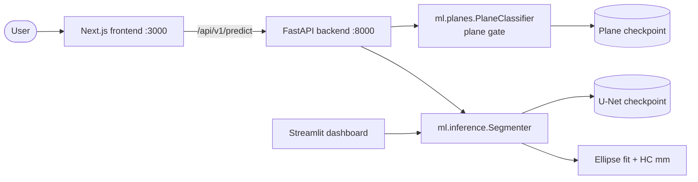
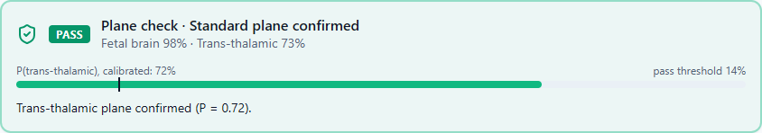
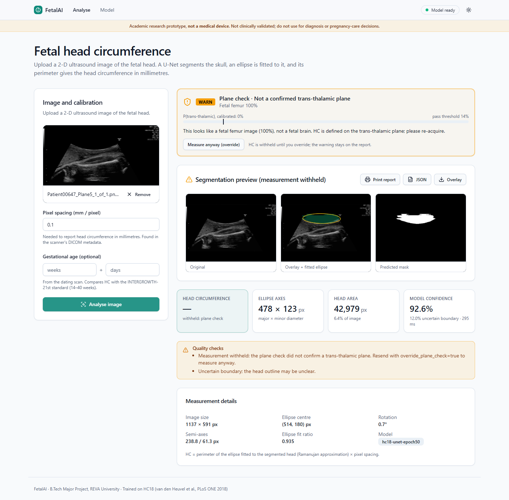
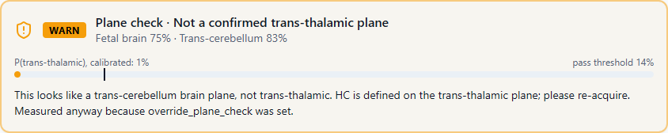
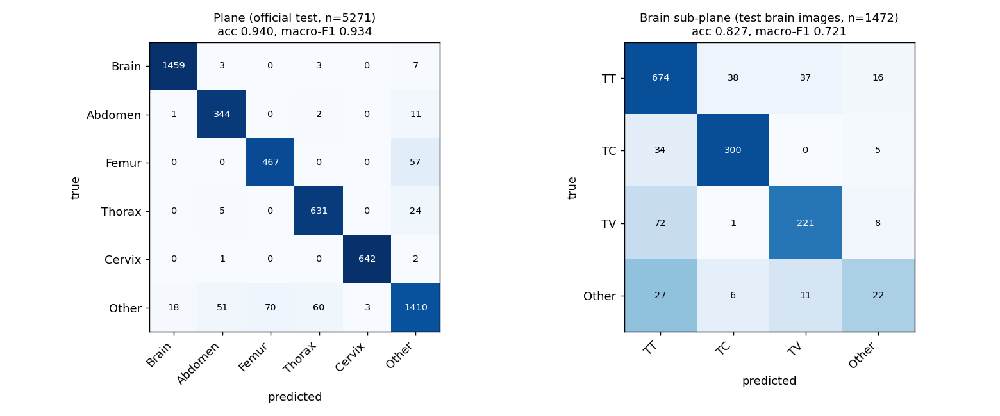
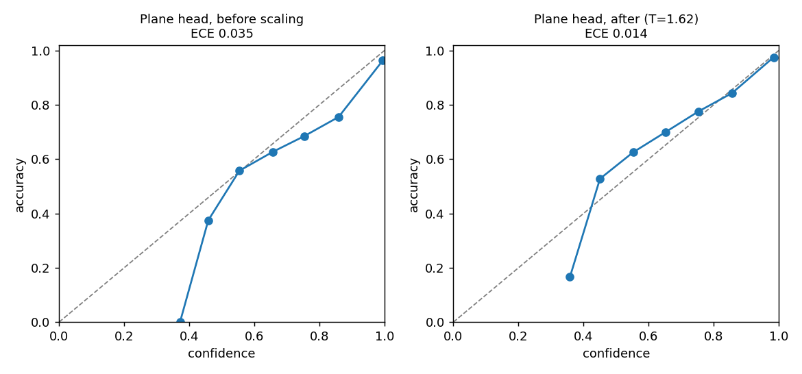

# FetalAI: Multimodal AI Fetal Screening

[](https://github.com/varshitha702/-Multimodal-AI-Fetal-Screening/actions/workflows/ci.yml)

B.Tech Major Project, REVA University. FetalAI first **checks that the ultrasound image is the standard
trans-thalamic plane** (a calibrated plane classifier), then segments the fetal head with a U-Net, fits an
ellipse to it and reports the **head circumference (HC) in millimetres**, through a FastAPI backend and a
Next.js web app.

> **Academic research prototype, not a medical device.** It is not clinically validated and must not be used
> for diagnosis, reassurance, triage or pregnancy-care decisions.


## Results (held-out test split, 151 images)

| Metric | Value |
|---|---|
| Dice | **0.973** ± 0.028 |
| IoU | 0.948 ± 0.046 |
| HC mean absolute error | **2.18 mm** (1.48 %) |
| HC bias, 95 % limits of agreement | −0.10 mm, [−5.89, +5.69] mm |

Trained on HC18 (van den Heuvel et al., *PLoS ONE* 2018) with a group-level split so no fetus is in both
training and test. Details and limitations: [`docs/MODEL_CARD.md`](docs/MODEL_CARD.md).

### Standard-plane quality gate (official FETAL_PLANES_DB test set, 5,271 images, unseen patients)

| Metric | Value |
|---|---|
| Plane accuracy / macro-F1 (6 classes) | **94.0 %** / 0.934 |
| Brain sub-plane accuracy / macro-F1 (TT, TC, TV, other) | 82.7 % / 0.721 |
| Calibration error (ECE), before → after temperature scaling | 0.035 → **0.014** |
| Trans-thalamic images accepted / non-brain images rejected | **95.7 %** / **99.8 %** |
| HC18 images accepted (domain shift, early gestation) | 60.3 % (override available) |

## Features

* **Standard-plane quality gate** (Feature A): an EfficientNet-B0 with a plane head and a brain sub-plane head,
  trained on FETAL_PLANES_DB with a patient-level split and temperature-scaled. If the image is not a confirmed
  trans-thalamic plane, the API withholds HC and says why ("please re-acquire"); an explicit override
  measures anyway. The UI shows a PASS / WARN badge before the result.
* **Segmentation + measurement:** U-Net → largest component → ellipse fit → Ramanujan perimeter × pixel spacing.
* **REST API** (FastAPI): `/api/v1/health`, `/api/v1/model-info`, `/api/v1/predict`, `/api/v1/plane-check`;
  validation with clear 400/413/415/422/503 errors; OpenAPI docs at `/docs`.
* **Web app** (Next.js + Tailwind + shadcn/ui): drag-and-drop upload, pixel spacing auto-filled for HC18
  images, original / overlay / mask views, metric cards, quality warnings, printable report, JSON download,
  model page, light/dark, mobile layout.
* **HC-for-gestational-age centile** (optional GA input) from the INTERGROWTH-21st fetal standard
  (Papageorghiou et al., *Lancet* 2014), verified against every cell of the official published table, with a
  centile chart. A comparison with a population standard, not a diagnosis.
* **Research dashboard** (Streamlit) using the same inference code.
* **Reproducible pipeline:** fixed-seed splits, GPU training, evaluation scripts, 114 automated tests, CI.

## Architecture



More diagrams (flowchart, UML use-case/class/sequence, DFD level 0/1): [`docs/ARCHITECTURE.md`](docs/ARCHITECTURE.md).

## Quickstart (Windows, from the repository root)

Prerequisites: Python 3.11, Node 22, an NVIDIA GPU for training (inference also runs on CPU).

```powershell
# 1. Python environment
py -3.11 -m venv .venv
.venv\Scripts\Activate.ps1
pip install torch==2.5.1 torchvision==0.20.1 --index-url https://download.pytorch.org/whl/cu121
pip install -r requirements-dev.txt

# 2. Dataset: download HC18 (doi:10.5281/zenodo.1327317) into data/raw/HC18 (see data/README.md)
python scripts\check_hc18.py

# 3. Train and evaluate (about 12 min on an RTX 4050 Laptop GPU)
python -m ml.train
python -m ml.evaluate

# 3b. Plane gate: download FETAL_PLANES_DB (Zenodo 3904280) into data/raw/FETAL_PLANES_DB, then
#     (about 17 min training + first-run image caching)
python -m ml.train_planes --size 320 --batch-size 32
python -m ml.evaluate_planes

# 4. Backend on http://localhost:8000 (docs at /docs)
scripts\run_backend.bat

# 5. Frontend on http://localhost:3000 (second terminal)
cd frontend
npm install
npm run dev
```

### Or with Docker (backend on CPU + frontend)

Needs Docker Desktop and the trained checkpoints `outputs/hc18_unet_best.pth` and
`outputs/plane_classifier_best.pth` (mounted read-only):

```powershell
docker compose up --build      # web app http://localhost:3000, API docs http://localhost:8000/docs
```

Optional research dashboard: `streamlit run dashboard\app.py`. Tests: `python -m pytest` and see
[`docs/TESTING.md`](docs/TESTING.md).

The trained checkpoints (`outputs/hc18_unet_best.pth`, 31 MB; `outputs/plane_classifier_best.pth`) are not
committed; steps 3 and 3b regenerate them. Without the plane checkpoint the API still runs and reports the plane
check as unavailable.

## Screenshots

| | |
|---|---|
| Upload |  |
| Plane check: PASS |  |
| Plane check: WARN (femur image, HC withheld) |  |
| Plane check: overridden |  |
| Plane classifier confusion matrices |  |
| Calibration before / after |  |
| Results (dark) |  |
| GA centile |  |
| Printable report |  |
| Model page |  |
| API docs |  |
| Training curves |  |
| Bug found: empty masks (before / after) |  |

## Repository layout

```text
ml/          data pipeline, U-Net, plane classifier, training, evaluation, geometry, inference (Python package)
backend/     FastAPI service (api / core / schemas / services)
frontend/    Next.js + TypeScript + Tailwind web app
dashboard/   Streamlit research dashboard (fallback UI)
scripts/     dataset check, figures, launchers, end-to-end UI check
tests/       pytest (ML + backend API)
docs/        architecture, API, dataset/model cards, testing, roadmap, ADRs, handoff, screenshots
data/        datasets (gitignored) + committed split CSV
outputs/     metrics, logs and plots (checkpoint gitignored)
legacy/      retired experiments, kept for history
```

## Documentation

[Architecture](docs/ARCHITECTURE.md) · [API](docs/API.md) · [Dataset card](docs/DATASET.md) ·
[Model card](docs/MODEL_CARD.md) · [Testing](docs/TESTING.md) · [Roadmap](docs/ROADMAP.md) ·
[ADRs](docs/adr/) · [Handoff](docs/HANDOFF.md) · [Changelog](CHANGELOG.md) · [Contributing](CONTRIBUTING.md)

## Team

| Member | Module |
|---|---|
| Pujari Varshitha | Dataset and preprocessing |
| Nachiketha K G | Model training and evaluation |
| Vishwas K | FastAPI backend and integration |
| Rakshitha V | Frontend |
| Yashwanth Gowda M N | Requirements, design docs, testing |

## Citation and licence of data

HC18: T. L. A. van den Heuvel, D. de Bruijn, C. L. de Korte, B. van Ginneken, "Automated measurement of fetal
head circumference using 2D ultrasound images", *PLoS ONE* 13(8): e0200412, 2018. Data: Zenodo
doi:10.5281/zenodo.1327317.

**Disclaimer:** research and teaching use only. Not a medical device.
