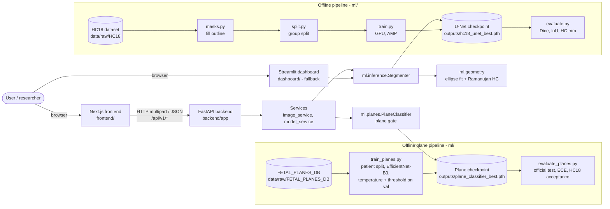
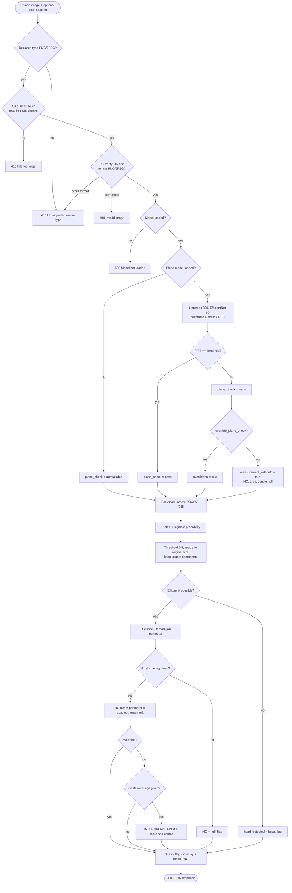
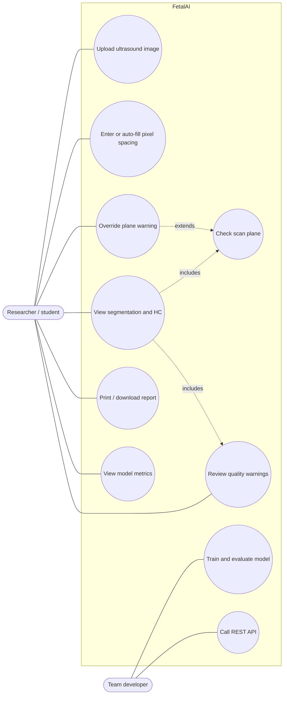
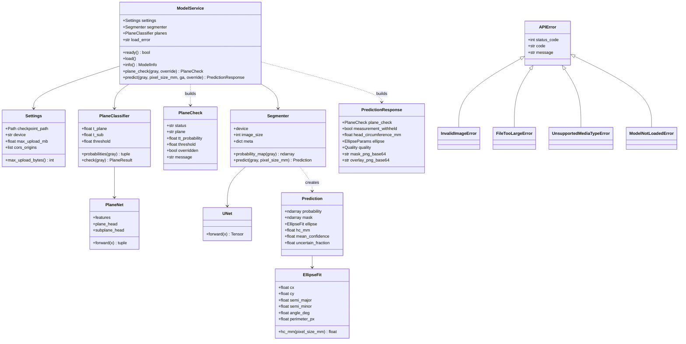
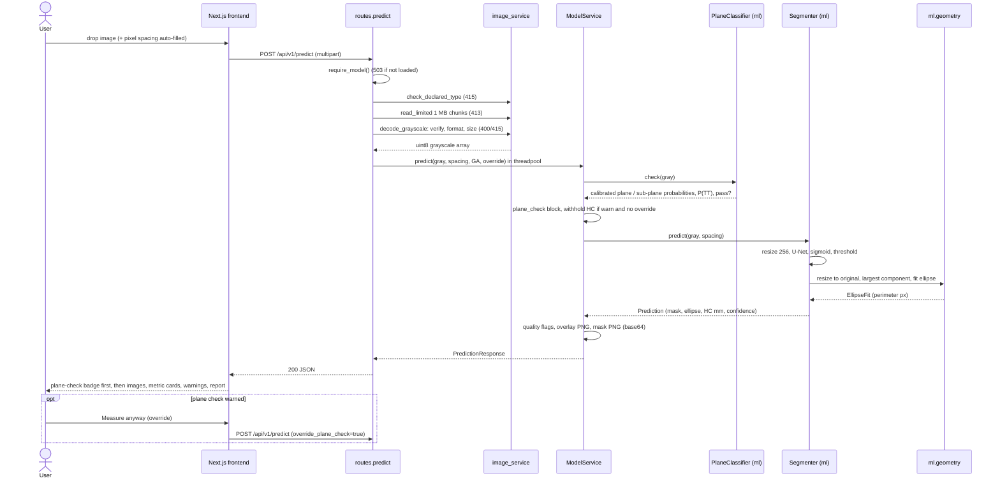
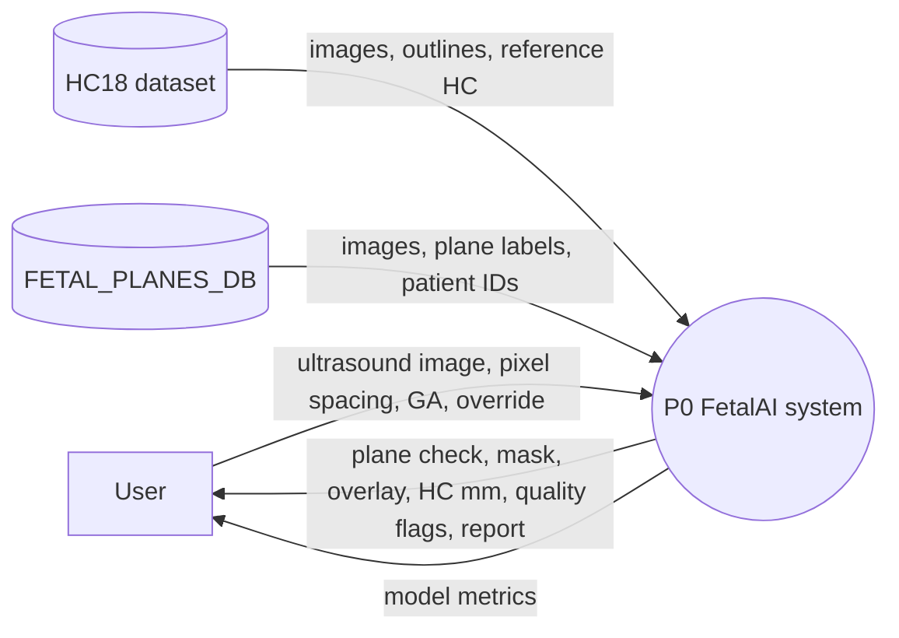
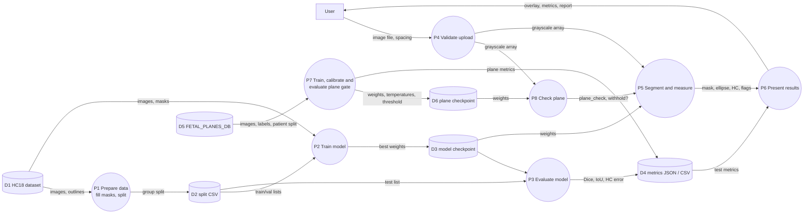

# Architecture

FetalAI first checks that a 2-D ultrasound image is the standard trans-thalamic plane (Feature A), then
segments the fetal head and measures head circumference (HC).
This document covers the system design, key decisions and the diagrams (architecture, flowchart, UML use-case,
class and sequence diagrams, DFD levels 0 and 1). Diagrams are Mermaid and render on GitHub.

> Academic research prototype, not a medical device.

## 1. System architecture



| Layer | Technology | Owner |
|---|---|---|
| Data pipeline | Python, OpenCV, pandas | Pujari Varshitha |
| Model training and evaluation | PyTorch 2.5 (CUDA 12.1), U-Net, EfficientNet-B0 plane classifier | Nachiketha K G |
| Backend API and integration | FastAPI, Pydantic v2, Uvicorn | Vishwas K |
| Frontend | Next.js 15, TypeScript, Tailwind, shadcn/ui | Rakshitha V |
| Requirements, design docs, testing | pytest, Playwright, GitHub Actions | Yashwanth Gowda M N |

## 2. Design decisions

Short records are in [`adr/`](adr/).

1. **One shared inference module (`ml/inference.py`).** The API, the Streamlit dashboard and the evaluation
   script all call the same `Segmenter`, so preprocessing, thresholding and HC geometry cannot drift apart.
   (Before this, the dashboard used a different resize and a pixel-contour perimeter.)
2. **Fill annotations at original resolution, then resize** (ADR-0001). Fixes the empty-mask bug.
3. **Group-level split by filename prefix** (ADR-0002). Repeat scans of the same fetus stay in one split.
4. **Measure HC at original resolution.** The 256 × 256 network input distorts the aspect ratio, so the mask
   is resized back before fitting the ellipse; pixel spacing is isotropic only there. HC = Ramanujan
   perimeter × pixel spacing (ADR-0003).
5. **Load the model once** in the FastAPI lifespan and run inference in a threadpool; the event loop stays free.
6. **Validate uploads defensively**: declared type (415), chunked size limit (413) before decoding,
   `PIL.Image.verify` (400), actual format (415), pixel limits (400). One error JSON shape for every error.
7. **Pixel spacing is an explicit input.** The model cannot know mm/px; HC is reported only when spacing is
   given. For HC18 demo images the frontend fills it from a SHA-256 lookup table.
8. **Clinical context only from a verified standard** (ADR-0005). The optional gestational age is used to place
   the measured HC on the INTERGROWTH-21st fetal standard; equations from the source paper, verified against
   all 189 cells of the official table.
9. **Standard-plane gate before measurement** (ADR-0006). A two-head EfficientNet-B0 trained on
   FETAL_PLANES_DB returns calibrated plane probabilities; if P(trans-thalamic) is below the validation-chosen
   threshold, the measurement is withheld unless the caller overrides. The gate is optional at runtime
   (`unavailable` if its checkpoint is missing).
10. **Segmentation quality indicators are heuristics** (confidence, uncertain-boundary fraction, border contact,
   ellipse-fit ratio), shown as warnings, not as calibrated uncertainty.

## 3. Flowchart: analysing one image



## 4. UML: use-case diagram



## 5. UML: class diagram (backend and ML core)



## 6. UML: sequence diagram for `POST /api/v1/predict`



## 7. Data-flow diagram, level 0 (context)



## 8. Data-flow diagram, level 1



## 9. Repository layout

```text
ml/         masks, metrics, dataset, split, model, train, evaluate, geometry, inference, intergrowth,
            planes, train_planes, evaluate_planes (Feature A)
backend/    FastAPI app: api/ (routes, deps), core/ (config, errors, logging), schemas/, services/
frontend/   Next.js app: src/app (pages), src/components (+ ui/), src/lib (API client, pixel-size lookup)
dashboard/  Streamlit research dashboard (uses ml.inference)
scripts/    dataset check, mask figures, pixel-size export, UI end-to-end check, log renderer, launchers
tests/      pytest: ML unit tests and backend/ API tests
docs/       this file, API, dataset card, model card, testing, roadmap, ADRs, screenshots, evidence
```
